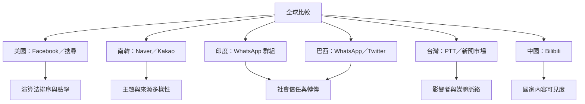

不同地區的案例不能只用同一個「演算法泡泡」解釋。美國 Facebook 研究分析新聞接觸、排序與點擊；南韓研究聚焦新聞聚合器個人化；印度與巴西案例凸顯私人通訊中的人際傳播；台灣研究則同時涉及新聞市場與 PTT 論壇；中國 Bilibili 研究分析國家來源內容在推薦系統中的可見度。

**區域文獻**：[[印度 WhatsApp 政治群組的錯誤資訊需要從社會傳播理解]]、[[巴西 WhatsApp 與 Twitter 的錯誤資訊各自運用不同修辭策略]]、[[台灣 PTT 疫苗錯誤資訊研究發現影響者與網絡位置值得關注]]、[[2026 台灣新聞使用報告顯示社群平台化改變新聞可見性與產業結構]]、[[中國 Bilibili 研究顯示推薦系統也可能放大國家來源內容]]。

**相關概念**：[[Socially_Mediated_Echo_Chamber]]、[[Homophily]]、[[Algorithmic_Curation]]、[[Platform_Governance]]。

**延伸想法**：[[為 Flyism 建立可追溯的多來源閱讀路徑]]。
