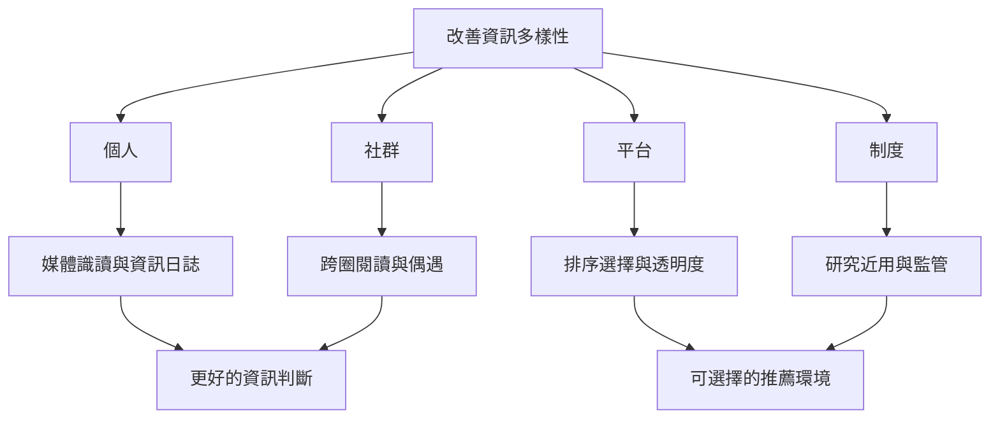

改善資訊多樣性需要不同層次的介入。個人可以追溯來源、比較觀點與安排跨領域閱讀；社群可以創造可信的非預期相遇；平台可以提供非個人剖析選項、透明度與可稽核性；制度則需確保研究者近用與使用者申訴權利。

**個人與社群**：[[媒體識讀應培養來源追溯與觀點比較能力]]、[[公共討論需要可選擇之外的非預期相遇]]、[[閱讀中的偶遇可以被設計但不必被強迫]]。

**平台與制度**：[[平台推薦治理需要選擇權透明度與可稽核性]]、[[歐盟數位服務法要求大型平台提供非個人剖析的推薦選項]]、[[媒體識讀介入整體有效但效果取決於介入方式與結果指標]]。

**核心概念**：[[Media_Literacy]]、[[Serendipity]]、[[Incidental_Exposure]]、[[Digital_Services_Act]]、[[Computational_Audit]]。

**行動設計**：[[每週用資訊飲食日誌觀察自己如何遇見新聞]]、[[設計一個每月一次的非預期閱讀交換會]]、[[替推薦清單加入一個可信的新奇性欄位]]、[[把反泡泡練習設計成可持續而非耗竭的微行動]]。
