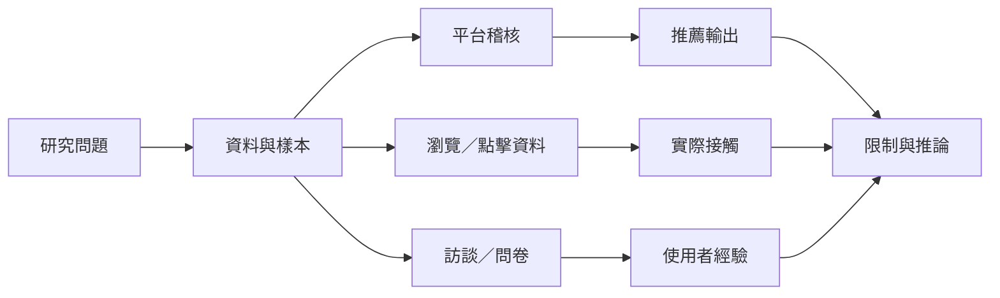

此概念的研究結果並不一致，原因包括平台不同、國家脈絡不同、推薦目標不同，以及研究者測量了不同階段的資訊接觸。可靠的整理方式不是投票決定「泡泡存在或不存在」，而是把研究的樣本、平台、時間、變項與推論範圍寫清楚。

**主要實證**：[[Facebook 資訊流中的跨立場接觸受到朋友網絡排序與點擊共同限制]]、[[搜尋與社群媒體可能增加接觸者之間的意識形態距離但不等於封閉]]、[[YouTube 錯假資訊推薦氣泡可能形成也可能被反證內容打破]]、[[南韓個人化新聞可能縮窄主題廣度卻擴大來源多樣性]]、[[南韓 2025 研究未發現個人化新聞必然放大政治偏見]]。

**研究方法**：[[推薦系統稽核結果高度依賴研究設計與帳號狀態]]、[[推薦系統稽核必須公開情境與可重現步驟]]。

**測量概念**：[[Content_Diversity]]、[[Source_Diversity]]、[[Ideological_Diversity]]、[[Computational_Audit]]。

**延伸想法**：[[建立主題輪替而非只追求左右立場平衡的閱讀清單]]。
