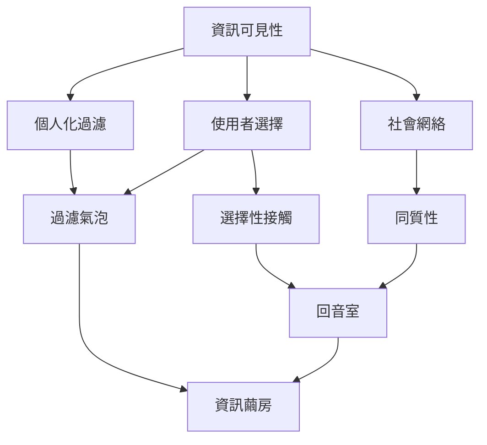

過濾氣泡研究的核心問題，是個人化資訊系統如何改變內容的可見性，以及這種改變如何與人的選擇、社會網絡和平台商業模式互相作用。閱讀時必須區分三種常見機制：演算法過濾、選擇性接觸與群體互相強化。

**核心概念**：[[Filter_Bubble]]、[[Echo_Chamber]]、[[Information_Cocoon]]、[[Selective_Exposure]]、[[Homophily]]、[[Algorithmic_Curation]]、[[Recommender_System]]。

**永久筆記**：[[過濾氣泡描述的是個人化系統如何塑造資訊可見性]]、[[過濾氣泡與回音室必須依機制區分]]、[[資訊環境由演算法與人的選擇共同形成]]、[[平台不是中性的資訊管道而是可見性的組織者]]。

**文獻入口**：[[個人化網路會隱藏使用者未曾表達需求的資訊]]、[[Facebook 資訊流中的跨立場接觸受到朋友網絡排序與點擊共同限制]]、[[搜尋與社群媒體可能增加接觸者之間的意識形態距離但不等於封閉]]。

**延伸探索**：[[每週用資訊飲食日誌觀察自己如何遇見新聞]]、[[以社群地圖辨認資訊來源是否過度依賴少數中介者]]。
