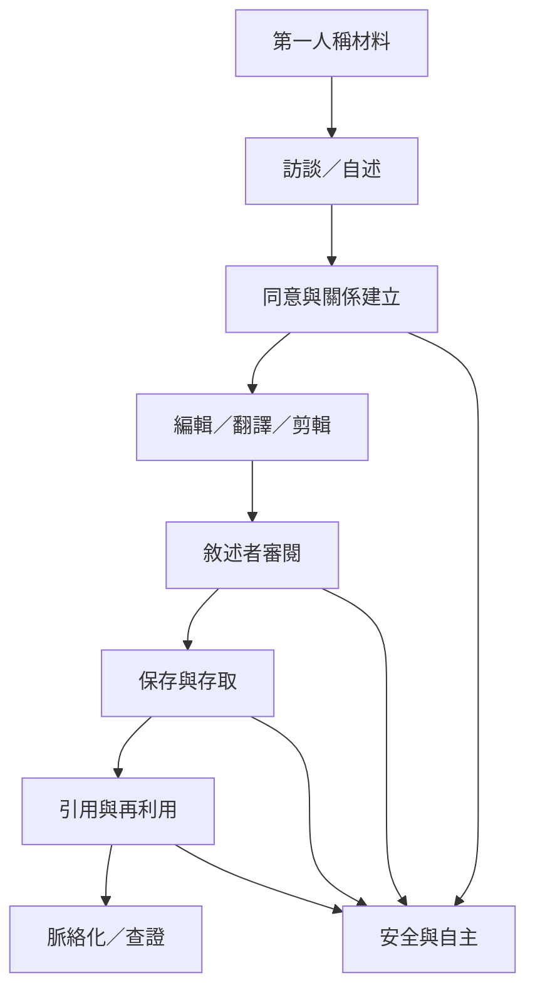

第一人稱敘事成為研究或公共記錄之前，會經過訪談、編輯、翻譯、保存與傳播。每一個環節都涉及權力和倫理；敘述者的同意、審閱、安全與公開選擇，需要和研究者的查證、脈絡化及保存責任共同考量。

## 思與行
* 將知情同意視為持續流程，而非一次簽名。
* 公開節錄時保留完整材料的脈絡與限制說明。
* 對創傷、身心障礙與原住民族故事，避免要求敘述者承擔教育大眾或療癒觀眾的責任。

## 參考
* [[敘述者應參與決定個人故事如何被保存與公開]]
* [[訪談與編輯會共同塑造故事因此必須公開中介過程]]
* [[見證的公共價值不能凌駕敘述者的安全與自主]]
* [[第一人稱見證需要與外部證據對話而非被當成無誤的歷史紀錄]]。
