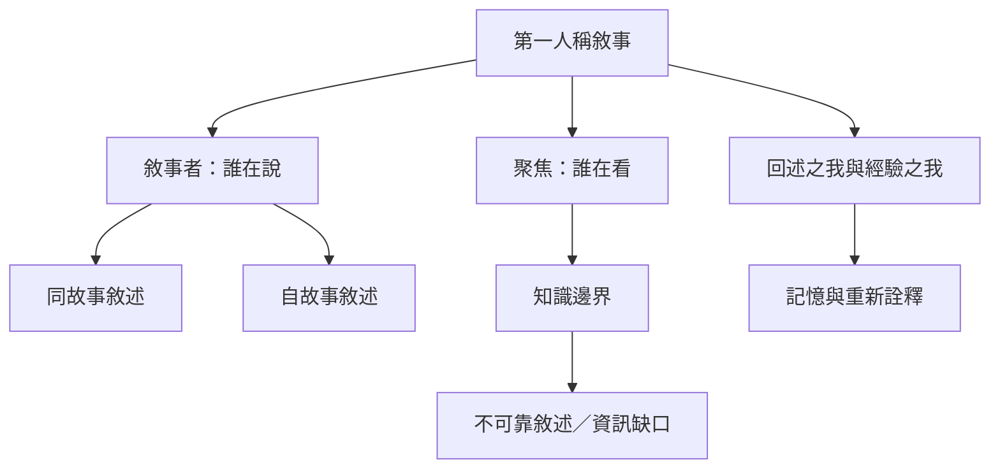

第一人稱敘事分析的起點，是將敘事者的發話位置與資訊聚焦位置分開。接著辨認回述之我與經驗之我，並分析讀者能知道什麼、敘述者不知道什麼。

## 思與行
* 分析任何故事時，將「說話者」「感知者」「作者」分開標記。
* 比較不同敘事視角如何改變讀者取得資訊的次序。

## 參考
* [[第一人稱敘事限制讀者能知道的資訊而不保證敘述者必然可信]]
* [[自傳中的回述之我與經驗之我具有不同知識位置]]
* [[回述之我會重新組織經驗因此生命故事永遠可以修訂]]
* [[聚焦]]、[[同故事敘述]]、[[自故事敘述]]。
