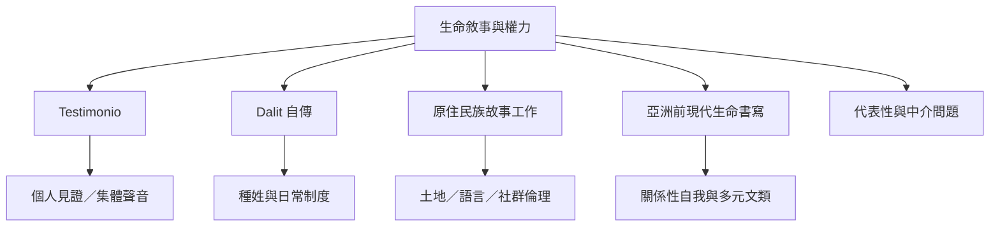

個人生命敘事永遠位於具體歷史與權力關係之中。testimonio 與 Dalit 自傳揭露受壓迫群體的經驗，原住民族故事工作重視關係知識與社群規範，亞洲生命書寫則提醒現代自主個人的概念並非普世標準。

## 思與行
* 跨文化比較時，先理解地方概念，再選擇是否使用通用文類標籤。
* 追問誰有發言權、誰整理翻譯、誰能公開，以及誰可能被代表性敘事排除。

## 參考
* [[拉丁美洲 testimonio 以個人見證連結集體受壓迫經驗]]
* [[Dalit 自傳以生命經驗揭露種姓制度的日常運作]]
* [[原住民族故事工作把敘事視為關係知識而非個人素材]]
* [[亞洲前現代生命書寫挑戰以自主個人為中心的自傳定義]]
* [[多元生命書寫應修正理論而不是只被既有理論收編]]。
