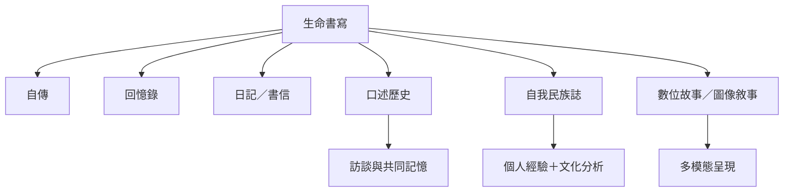

生命書寫是一個跨文類、跨媒介的概念傘。自傳與回憶錄偏向文字生命敘事，口述歷史透過訪談保存回憶，自我民族誌將個人經驗連回文化分析，數位故事則運用聲音與影像拓展表達形式。

## 思與行
* 比較同一生命事件以自傳、訪談錄音與數位影片呈現時，哪些細節被凸顯或消失。
* 依材料目的選擇文類，不要求每段生命經驗都寫成完整自傳。

## 參考
* [[生命書寫涵蓋自傳回憶錄日記影像與數位自我呈現]]
* [[自我民族誌把個人經驗轉化為理解文化的研究材料]]
* [[口述歷史是訪談者與敘述者共同形成的記憶紀錄]]
* [[數位故事讓跨國參與者以多模態方式呈現自己的行動經驗]]。
