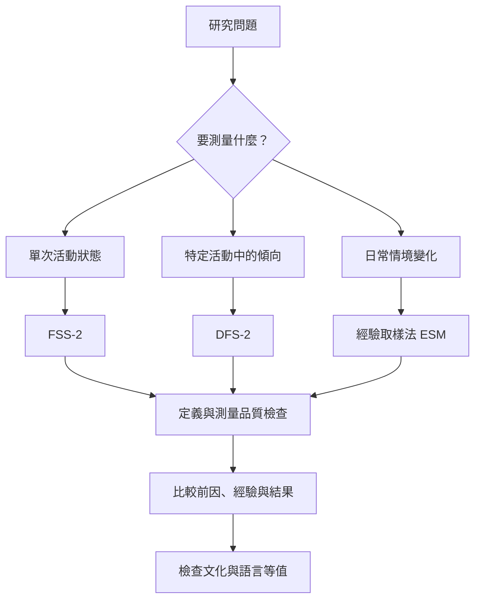

心流既是當下狀態，也是可在特定活動中反覆出現的傾向。經驗取樣法擅長捕捉日常脈絡與時間變化，FSS-2／DFS-2 提供標準化的狀態與傾向測量；但不同研究對心流定義的操作化不一，跨文化比較也需要檢查測量等值。

[[Flow_state_scale]]、[[Experience_sampling_method]]、[[Flow_(psychology)]]、[[Challenge_skill_balance]]

## 思與行
* 使用這張地圖安排閱讀順序，並在新研究出現時調整概念之間的關係。
* 不把圖中的箭頭視為已證實的因果；它們是整理理論關係的工作模型。

## 參考
* 方法：[[經驗取樣法能減少回憶偏誤並捕捉日常心流的起伏]]。
* 批判：[[心流的定義與測量仍存在足以影響研究比較的分歧]]。
* 來源：[Csikszentmihalyi & Larson (1987), Validity and Reliability of the Experience-Sampling Method](https://pubmed.ncbi.nlm.nih.gov/3655778/)；[Jackson & Eklund (2002), Assessing Flow in Physical Activity: The FSS-2 and DFS-2](https://doi.org/10.1123/jsep.24.2.133)；[Abuhamdeh (2020), Investigating the “Flow” Experience: Key Conceptual and Operational Issues](https://doi.org/10.3389/fpsyg.2020.00158)
