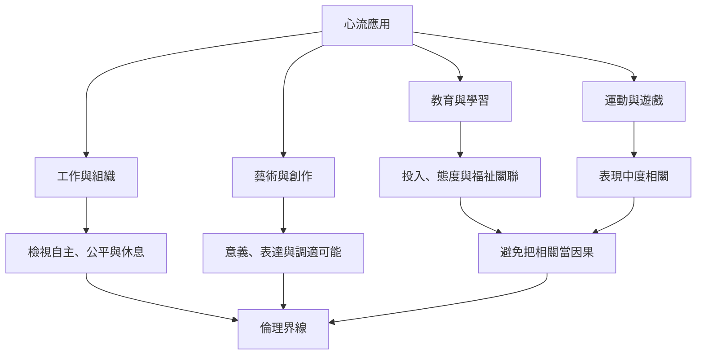

心流研究可應用於教育、運動、藝術、音樂、工作和數位媒介，但應用的倫理與證據強度各有不同。學習心流與多種正向學習變項相關，運動／電玩心流與表現也有中度相關；然而相關不等於因果。工作心流更不代表勞動者擁有自主權或良好工作條件。

[[Flow_(psychology)]]、[[Work_engagement]]、[[Intrinsic_motivation]]、[[Mindfulness]]、[[Positive_psychology]]

## 思與行
* 使用這張地圖安排閱讀順序，並在新研究出現時調整概念之間的關係。
* 不把圖中的箭頭視為已證實的因果；它們是整理理論關係的工作模型。

## 參考
* 教育證據：[[教育心流與優質任務、支持環境及學習結果呈穩定正相關]]。
* 工作界線：[[工作中的心流不等於工作值得或勞動者擁有自主權]]。
* 因果限制：[[心流與表現的相關不能直接證明心流造成績效提升]]。
* 來源：[Xie et al. (2026), Learning Flow in Educational Contexts: A Meta-analysis](https://doi.org/10.1111/bjep.70075)；[Harris et al. (2021), A Systematic Review and Meta-analysis of the Relationship Between Flow States and Performance](https://doi.org/10.1080/1750984X.2021.1929402)；[Csikszentmihalyi & LeFevre (1989), Optimal Experience in Work and Leisure](https://pubmed.ncbi.nlm.nih.gov/2724069/)
