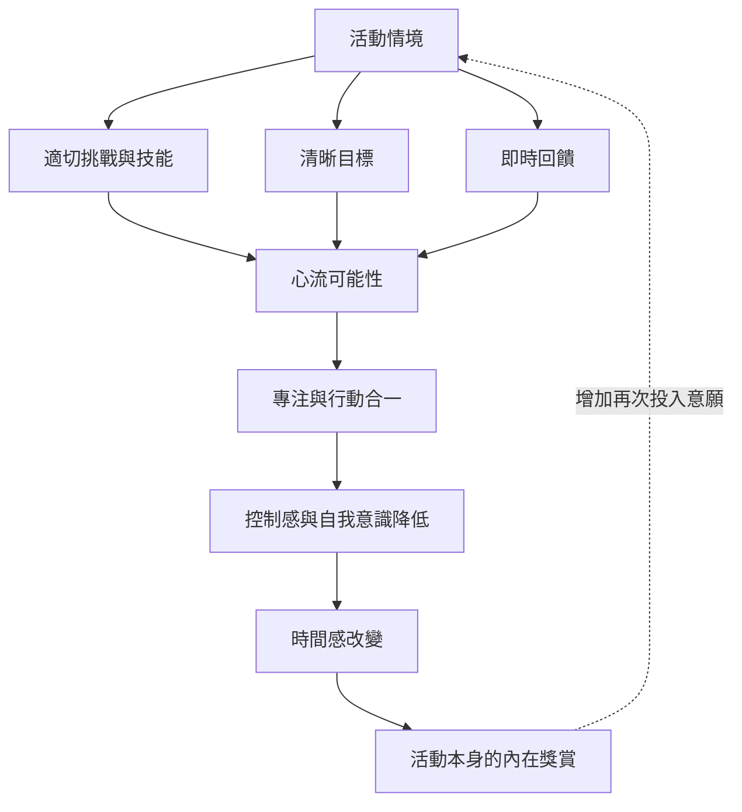

本圖將心流視為一種動態經驗：任務條件提供可能性，注意力與行動在活動中整合，內在獎賞則讓投入本身具有價值。九項特徵不等於每次必備的清單；研究者仍需區分前提、經驗與後果。

[[Flow_(psychology)]]、[[Optimal_experience]]、[[Challenge_skill_balance]]、[[Flow_channel_model]]、[[Autotelic_experience]]、[[Intrinsic_motivation]]、[[Clear_goals]]、[[Immediate_feedback]]、[[Concentration]]、[[Action_awareness_merging]]、[[Sense_of_control]]、[[Loss_of_self_consciousness]]、[[Time_transformation]]

## 思與行
* 使用這張地圖安排閱讀順序，並在新研究出現時調整概念之間的關係。
* 不把圖中的箭頭視為已證實的因果；它們是整理理論關係的工作模型。

## 參考
* 概念綜述：[[心流把完整投入理解為活動本身就值得的最佳經驗]]。
* 九項特徵與條件：[[心流的九項特徵可區分為形成條件與主觀經驗成分]]。
* 來源：[Nakamura & Csikszentmihalyi (2002), The Concept of Flow](https://doi.org/10.1093/oso/9780195135336.003.0007)；[Peifer et al. (2022), A Scoping Review of Flow Research](https://doi.org/10.3389/fpsyg.2022.815665)
