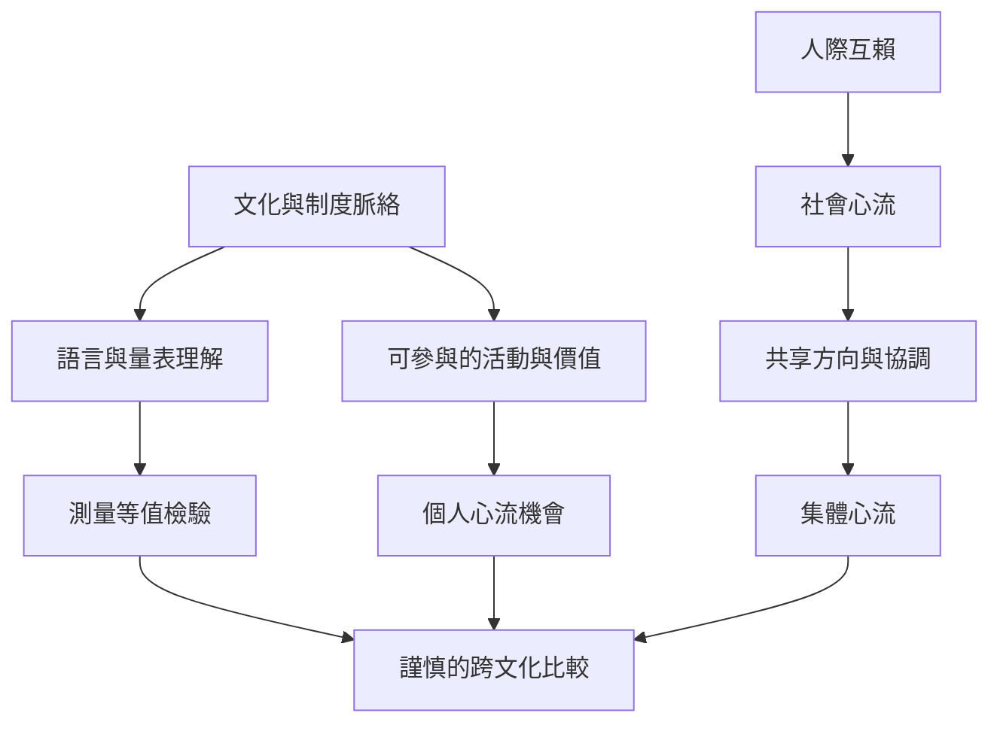

個體心流可能發生於社會場景，但集體心流還要求共享方向、互相回應與共同協調。文化則既影響人們可參與哪些活動，也影響「投入」「控制」「自我」和「挑戰」的意義。跨文化研究應同時檢驗量表可比性與地方生活脈絡。

[[Flow_(psychology)]]、[[Social_flow]]、[[Collective_flow]]、[[Intrinsic_motivation]]、[[Flow_state_scale]]

## 思與行
* 使用這張地圖安排閱讀順序，並在新研究出現時調整概念之間的關係。
* 不把圖中的箭頭視為已證實的因果；它們是整理理論關係的工作模型。

## 參考
* 全球回顧：[[心流在全球多種活動中出現但各地研究分布並不平均]]。
* 跨文化測量：[[跨文化量表研究支持心流核心結構但提醒翻譯與群體差異]]。
* 來源：[Peifer et al. (2022), A Scoping Review of Flow Research](https://doi.org/10.3389/fpsyg.2022.815665)；[Koehn, Asci & Caglar (2026), Cross-Cultural Differences in the Experience of Flow](https://doi.org/10.1007/s41042-026-00281-1)；[Sawyer (2003), Group Creativity: Music, Theater, Collaboration](https://www.routledge.com/Group-Creativity-Music-Theater-Collaboration/Sawyer/p/book/9780805844368)
