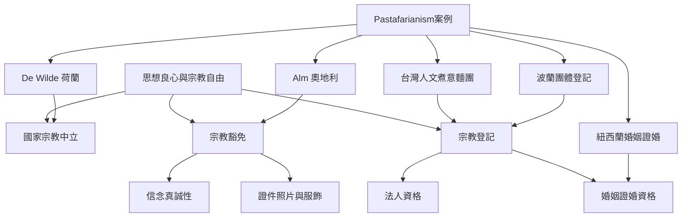

本圖將法律案例拆成幾個不同層次：個人信念是否受保護、國家是否中立、團體能否登記、特定場合是否有豁免，以及個案結果是否具有普遍法律效果。

關聯概念：[[思想、良心與宗教自由]]、[[國家宗教中立]]、[[宗教豁免]]、[[信念真誠性]]、[[宗教登記]]。

延伸卡片：[[宗教豁免的公平性取決於如何判斷信念真誠]]、[[國家宗教中立要求制度不要代替個人判定信仰真假]]、[[宗教團體登記與宗教自由是不同法律層次]]、[[法律判決必須區分個案效果與普遍宗教地位]]。
