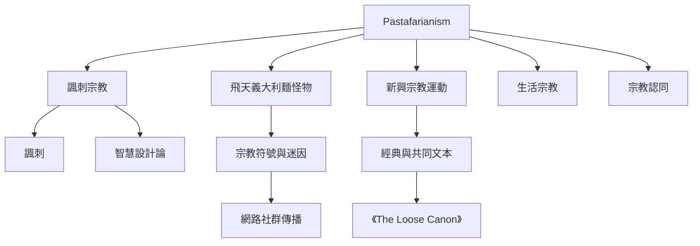

本圖整理 Pastafarianism 如何從諷刺文本形成多重身分實踐。理解重點不是選出唯一正確標籤，而是觀察諷刺、神祇形象、共同文本、參與者生活與宗教分類之間的互動。

關聯概念：[[飛天義大利麵怪物]]、[[Pastafarianism]]、[[諷刺宗教]]、[[諷刺]]、[[新興宗教運動]]、[[生活宗教]]、[[認知宗教科學]]、[[迷因]]。

延伸卡片：[[Pastafarianism可以同時是諷刺身分與社群實踐]]、[[網路社群透過共享文本與符號使諷刺宗教跨國擴散]]、[[對宗教的諷刺必須與對宗教人士的尊重同時成立]]。
