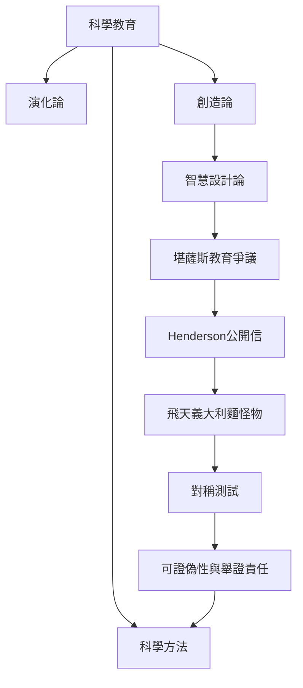

本圖整理 FSM 起源的教育脈絡：創造論與智慧設計論進入公立科學教育的爭議，促成 Henderson 用一個平行創造者主張進行反諷，從而凸顯科學主張與宗教主張的判準問題。

關聯概念：[[智慧設計論]]、[[創造論]]、[[科學方法]]、[[可證偽性]]、[[Russell's teapot]]、[[類比論證]]。

延伸卡片：[[諷刺宗教把不可反駁的主張轉化為對稱測試]]、[[濾盆把抽象的宗教自由轉化成可見的公共爭議]]。
