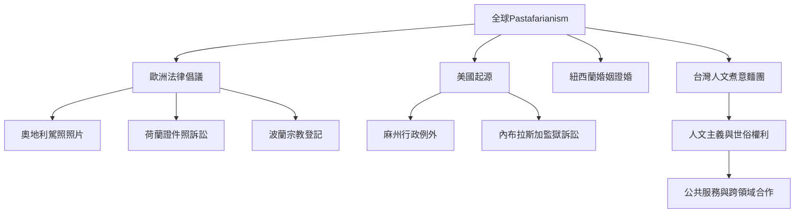

同一個全球運動會因法律制度、地方人文主義網絡與公共議題而出現不同樣貌。比較時應以「個案法律功能」和「地方參與實踐」為核心，而非單純排列國家是否認可。

關聯概念：[[宗教登記]]、[[宗教豁免]]、[[世俗主義]]、[[國家宗教中立]]、[[新興宗教運動]]。

延伸卡片：[[台灣案例顯示諷刺宗教也能結合人文主義與公共服務]]、[[建立跨國宗教豁免比較表避免把不同法律資格混為一談]]、[[以台灣人文煮意麵團作為地方公共人文合作的研究起點]]。
