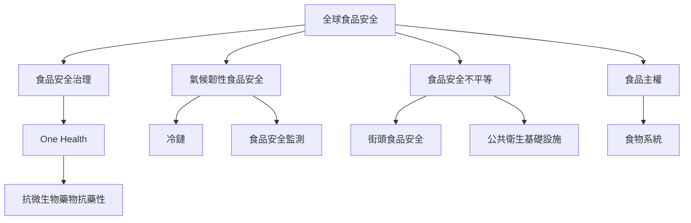

食品安全風險在全球分布不均，受到公共衛生基礎設施、監測能力、工作條件、氣候與供應鏈韌性影響。One Health將人類、動物與環境資料連接；氣候韌性則讓冷鏈、供水與地方食物系統能面對熱浪、洪水、乾旱與停電。

## Mermaid 關係圖

## 概念連結
* [[食品安全不平等]]、[[食品安全治理]]、[[食品主權]]、[[食物系統]]。
* [[One Health]]、[[抗微生物藥物抗藥性]]、[[食品安全監測]]。
* [[氣候韌性食品安全]]、[[冷鏈]]、[[街頭食品安全]]。

* [[迦納焦點團體訪談指出街頭食安障礙也包括制度信任與攤商可見性]]

## 延伸筆記
* [[食品安全不平等反映水電冷鏈與監測能力的差距]]。
* [[One Health要求同時管理人類動物與環境中的食品風險]]。
* [[氣候適應必須納入食品鏈冷鏈與水安全]]。
* [[小型攤商的安全表現受到設備與制度接觸影響]]。
