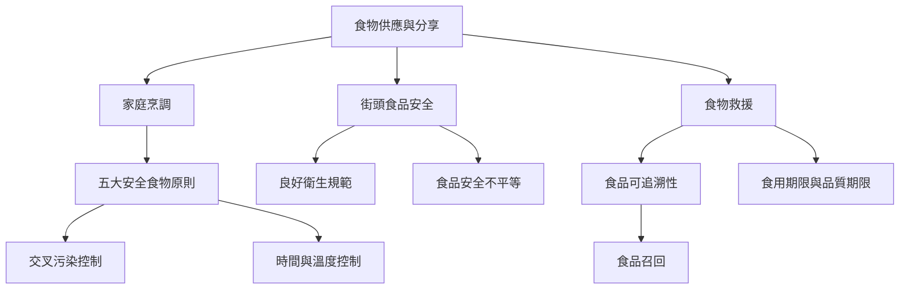

這張圖把家庭廚房、街頭攤位、社區共食與食物救援放在同一個實作脈絡。核心問題不是場域名稱，而是食材來源、供水、手部衛生、生熟分流、時間溫度、過敏原及資訊能否被妥善管理。對小型供食者，改善設備與流程必須並行。

## Mermaid 關係圖

## 概念連結
* [[食品安全]]、[[街頭食品安全]]、[[食物救援]]、[[食物系統]]。
* [[良好衛生規範]]、[[交叉污染]]、[[時間與溫度控制]]、[[冷鏈]]。
* [[食品可追溯性]]、[[食品召回]]、[[食品過敏原]]、[[食用期限與品質期限]]。
* [[食品安全文化]]、[[食品安全不平等]]。

* [[消費者的可見潔淨感不能代替風險控制]]

## 延伸筆記
* [[交叉污染常發生於生熟食與工作流程的轉換處]]。
* [[時間與溫度必須被當成可累積的控制變數]]。
* [[食物救援必須把減廢目標與食品安全底線一起設計]]。
* [[台灣社區共食可以用最小化風險流程建立信任]]。
