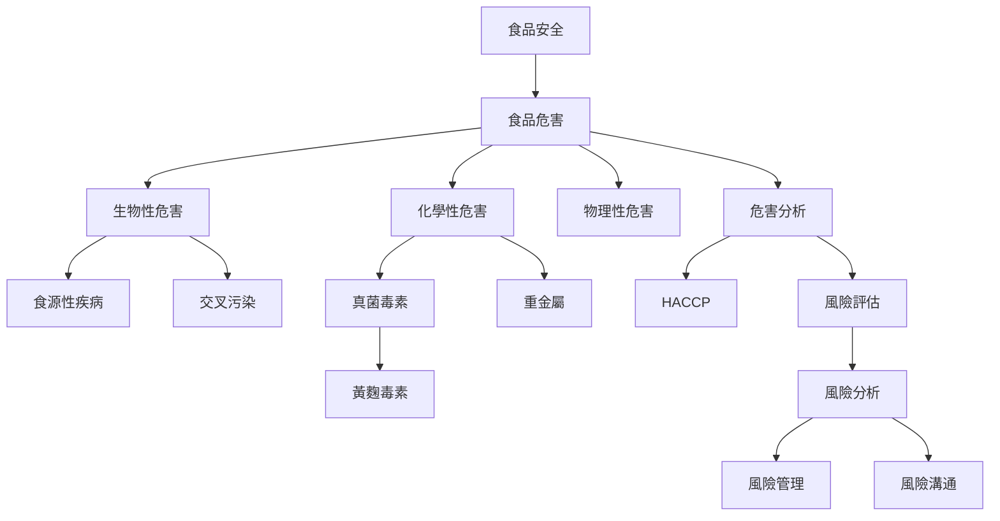

本圖從「食品中可能存在什麼危害」出發，連接風險評估、危害控制與監測。生物性危害偏重病原傳播、交叉污染、加熱與冷藏；化學性危害則更依賴污染來源、暴露量、抽樣與長期風險評估。危害存在不等於實際風險必然很高，必須把暴露與脆弱性納入判斷。

## Mermaid 關係圖

## 概念連結
* [[食品安全]]、[[食品危害]]、[[生物性危害]]、[[化學性危害]]、[[物理性危害]]。
* [[食源性疾病]]、[[交叉污染]]、[[危害分析]]、[[HACCP]]。
* [[風險分析]]、[[風險評估]]、[[風險管理]]、[[風險溝通]]。
* [[真菌毒素]]、[[黃麴毒素]]、[[重金屬]]、[[食品過敏原]]。

## 延伸筆記
* [[食品風險應先辨識危害再考慮暴露與脆弱性]]。
* [[生物性與化學性危害具有不同時間尺度]]。
* [[交叉污染常發生於生熟食與工作流程的轉換處]]。
* [[食物中的化學污染需要追查長期暴露與來源途徑]]。
