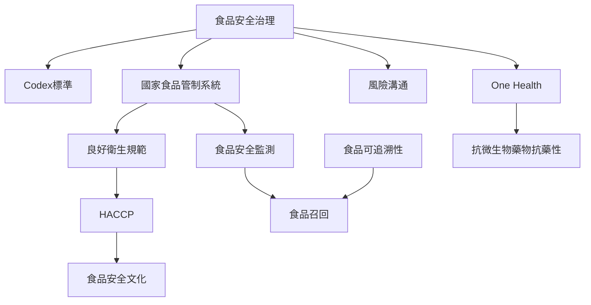

食品安全治理由國際標準、國家主管機關、食品業者、工作者、科學界與消費者共同構成。Codex提供國際標準基礎，FAO／WHO評估工具協助檢視國家能力；GHP與HACCP把制度要求落到日常製程；追溯、監測與召回則讓系統在事故發生時能辨識並限制影響。

## Mermaid 關係圖

## 概念連結
* [[食品安全治理]]、[[食品安全]]、[[良好衛生規範]]、[[良好農業規範]]、[[良好製造規範]]、[[HACCP]]。
* [[食品安全文化]]、[[食品安全監測]]、[[食品可追溯性]]、[[食品召回]]。
* [[風險溝通]]、[[One Health]]、[[抗微生物藥物抗藥性]]。

## 延伸筆記
* [[食品安全是公共衛生與食物系統共同產生的結果]]。
* [[HACCP有效性取決於現場驗證與修正而非表格]]。
* [[追溯資料與公開溝通能把食品召回變成可行動的保護]]。
* [[食品安全文化由資源制度與日常行為共同塑造]]。
