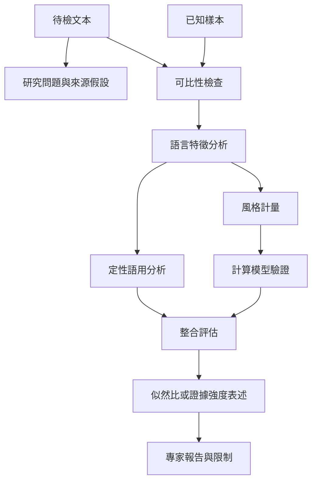

作者分析的流程由問題設定、語料建立、特徵比較到證據評價組成。語料可比性、文本長度、交際情境及可重現性共同限制推論。

## 概念索引
- [[作者歸屬分析]]、[[作者側寫]]、[[風格計量]]、[[語料庫語言學]]、[[似然比]]、[[可重現性]]

## 核心論述
- [[作者歸屬分析只能回答特定比較假設]]、[[作者歸屬與作者側寫回答不同問題]]、[[語言特徵必須放回交際目的與文類理解]]、[[文本長度與語境差異會限制作者比對]]、[[似然比描述證據對競爭假設的支持程度]]、[[聲音比較必須驗證效度與可靠度]]、[[多語言司法需要在地語料與在地專業知識]]、[[語言來源分析的地域判斷必須避免過度確定]]

## 回鏈
- [[data/2026年作者分析回顧整理機器學習深度學習與大型語言模型]]
- [[Forensic_linguistics]]
- [[data/Unabomber案件展示語言比對如何成為調查線索而非單獨定罪]]
- [[data/文字語言學作者分析應兼顧語用功能與整體風格]]
- [[data/早期作者風格研究已指出語料長度與方法效度的限制]]
- [[data/法庭語言學橫跨法律文本司法互動與語言證據]]
- [[data/英國法庭語言學從文本鑑識延伸至緊急通訊與網路犯罪]]
- [[data/計算式作者驗證研究必須同時報告效能與適用範圍]]
