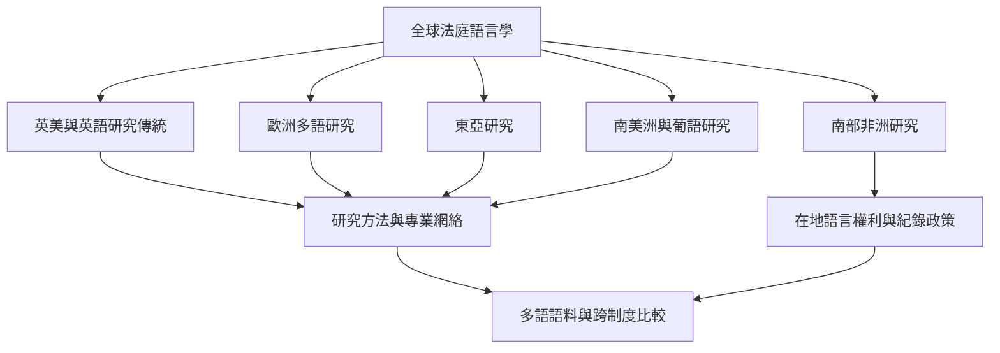

跨國比較應同時檢視語言、法律制度、資料庫收錄、專業訓練與語言權利，避免以英語研究量代表整個領域的發展程度。

## 概念索引
- [[法庭語言學]]、[[多語言司法]]、[[語言權利]]、[[語料庫語言學]]

## 核心論述
- [[法庭語言學的三個分支需要不同的證據標準]]、[[語言特徵必須放回交際目的與文類理解]]、[[文本長度與語境差異會限制作者比對]]、[[司法口譯會共同塑造案件紀錄]]、[[多語言司法需要在地語料與在地專業知識]]、[[演算法偏差可能把語言差異轉成司法風險]]、[[法庭語言學需要把弱勢參與者納入研究中心]]、[[研究方法必須對應實際法律問題]]

## 回鏈
- [[Forensic_linguistics]]
