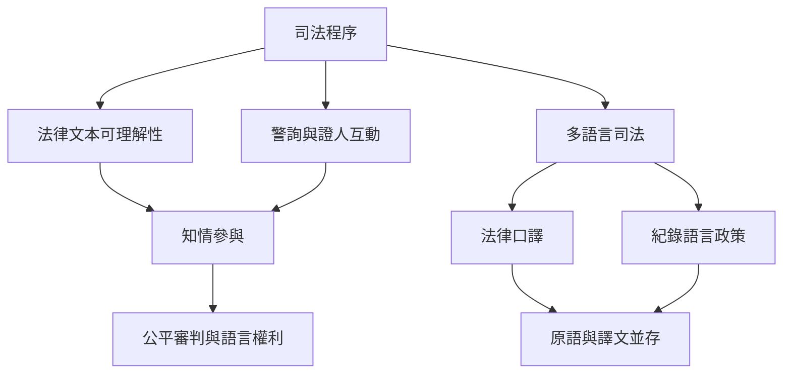

司法溝通的公平性不只在於當事人有沒有發言機會，也取決於其是否理解程序、能否以熟悉語言表達，以及口譯和紀錄是否可被檢查。

## 概念索引
- [[法律可理解性]]、[[警詢]]、[[法律口譯]]、[[語言權利]]、[[公平審判]]、[[脆弱證人]]

## 核心論述
- [[法律文本的可理解性是公平審判的一部分]]、[[法律語言的精確與可理解需要共同設計]]、[[警詢逐字稿並非未經塑造的自然紀錄]]、[[司法口譯會共同塑造案件紀錄]]、[[多語言司法需要在地語料與在地專業知識]]、[[演算法偏差可能把語言差異轉成司法風險]]、[[法庭語言學需要把弱勢參與者納入研究中心]]、[[全球法庭語言學發展不能只用英語出版量衡量]]

## 回鏈
- [[data/Coulthard指出法律書面語口語程序與專家證言構成三個研究層次]]
- [[Forensic_linguistics]]
- [[data/中國法庭語言學發展出法律話語與網路語言研究路線]]
- [[data/南部非洲案例凸顯訴訟語言與紀錄語言之間的權力落差]]
- [[data/台灣刑法語言研究指出法律必須在模糊與精確之間作出解釋]]
- [[data/法庭語言學橫跨法律文本司法互動與語言證據]]
- [[data/法庭語言學的範圍會隨法律制度與研究問題而改變]]
- [[data/澳洲法庭語言學研究重視語言意識形態與社會文化脈絡]]
- [[data/研究法庭語言學必須從可檢驗的法律問題開始]]
- [[data/簡化陪審團指示語言能改善理解但不能省略法律精確性]]
