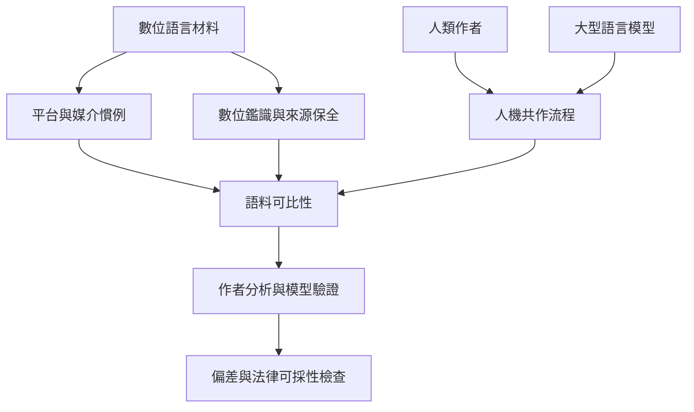

平台、轉貼、多人協作、自動更正與生成式模型都可能影響文本來源。數位語言分析必須與數位保全、模型驗證及偏差審查整合。

## 概念索引
- [[數位鑑識]]、[[大型語言模型]]、[[作者歸屬分析]]、[[機器學習]]、[[效度]]、[[鑑識倫理]]

## 核心論述
- [[作者歸屬分析只能回答特定比較假設]]、[[作者歸屬與作者側寫回答不同問題]]、[[語言特徵必須放回交際目的與文類理解]]、[[文本長度與語境差異會限制作者比對]]、[[似然比描述證據對競爭假設的支持程度]]、[[聲音比較必須驗證效度與可靠度]]、[[數位文本的作者分析必須納入平台與生成工具]]、[[演算法偏差可能把語言差異轉成司法風險]]

## 回鏈
- [[data/2026年作者分析回顧整理機器學習深度學習與大型語言模型]]
- [[Forensic_linguistics]]
- [[data/四十年書目回顧顯示數位分析成長仍有地理代表性缺口]]
- [[data/機器學習擴大語言分析規模但不會自動消除偏差]]
- [[data/計算式作者驗證研究必須同時報告效能與適用範圍]]
