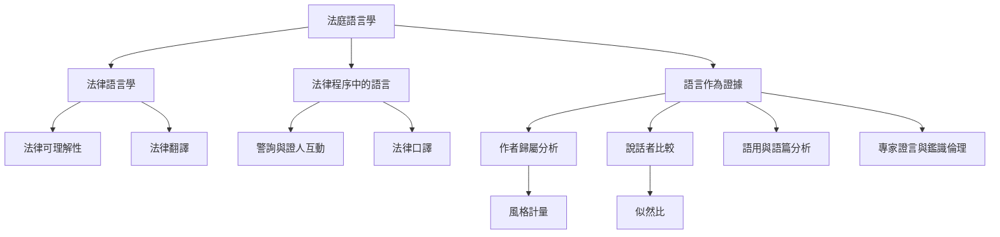

法庭語言學可視為法律文本、司法互動與語言證據三個面向的交會。它們共用語言學知識，但使用不同資料、研究方法與品質標準。

## 概念索引
- [[法庭語言學]]、[[法律語言學]]、[[語言作為證據]]、[[法律可理解性]]、[[警詢]]、[[作者歸屬分析]]、[[說話者比較]]、[[專家證人]]

## 核心論述
- [[法庭語言學的三個分支需要不同的證據標準]]、[[作者歸屬分析只能回答特定比較假設]]、[[作者歸屬與作者側寫回答不同問題]]、[[語言特徵必須放回交際目的與文類理解]]、[[文本長度與語境差異會限制作者比對]]、[[似然比描述證據對競爭假設的支持程度]]、[[聲音比較必須驗證效度與可靠度]]、[[法律文本的可理解性是公平審判的一部分]]

## 回鏈
- [[data/Coulthard訪談呈現語言證據如何介入錯誤自白與商標爭議]]
- [[Forensic_linguistics]]
- [[data/RMIT專訪呈現警詢專家工作需要跨國與跨文化視角]]
- [[data/Routledge手冊呈現法庭語言學已形成多元研究共同體]]
- [[data/Writing Wrongs播客以真實案例呈現語言鑑識的能力與限制]]
- [[data/法庭語言學方法必須保留可供覆核的分析軌跡]]
- [[data/法庭語言學研究成長但研究資源仍集中於少數國家]]
- [[data/語言作為證據需要專家倫理與可理解的法庭溝通]]
- [[data/語言來源分析不能把口音直接等同國籍或真實身分]]
