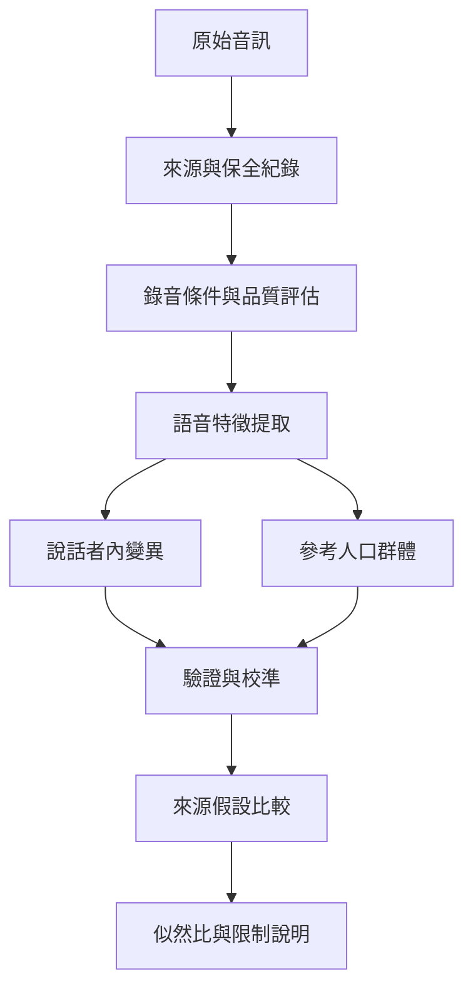

語音證據需從原始音訊與錄音條件開始，並在說話者內變異、人口群體、方法驗證與競爭假設中評估，而不能把聲音相似直接當成身分確認。

## 概念索引
- [[法庭語音學]]、[[說話者比較]]、[[似然比]]、[[效度]]、[[可靠度]]

## 核心論述
- [[作者歸屬分析只能回答特定比較假設]]、[[似然比描述證據對競爭假設的支持程度]]、[[聲音比較必須驗證效度與可靠度]]、[[語言來源分析的地域判斷必須避免過度確定]]、[[演算法偏差可能把語言差異轉成司法風險]]、[[專家應報告證據強度而不是替法院決定事實]]、[[鑑識語言分析必須可重現可審查]]、[[研究方法必須對應實際法律問題]]

## 回鏈
- [[Forensic_linguistics]]
- [[data/聲音比較的似然比框架要求明確列出競爭假設]]
- [[data/聲音比較的共識文件把方法驗證視為核心要求]]
- [[data/自動語音辨識準確度提高不代表鑑識可靠度同步提高]]
- [[data/英國國會科技簡報提醒語言來源分析與聲音辨識並非零錯誤]]
