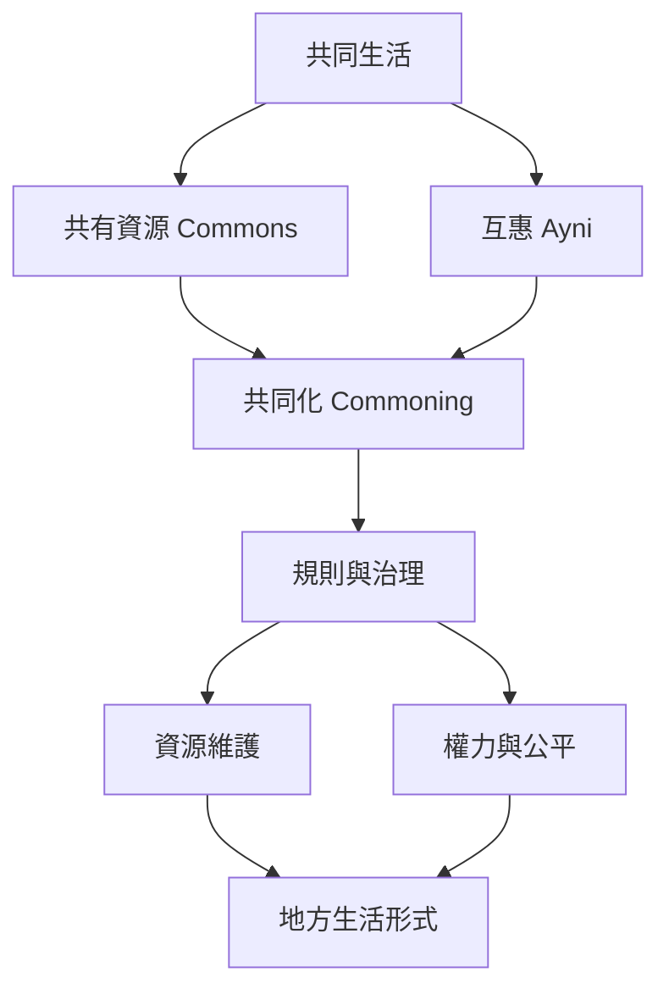

共同生活需要制度化的資源分享、互惠與治理，但制度不是一次設計後便固定不變。安地斯 ayni、commons 與 commoning 提供不同分析切口：互惠如何延續關係，共享資源如何制定規則，以及權力如何影響共同參與。

## 延伸閱讀

閱讀[[Ayni]]、[[共有資源（Commons）]]和[[共同化（Commoning）]]，再連結[[互惠讓資源流動成為持續的社會關係]]與[[共同生活的評價必須同時檢視可行性正義與支配]]。

## 參考

* [[安地斯互惠制度以回饋關係維持共同生計]]
* [[Commoning是共同關係與治理持續生成的實踐]]
