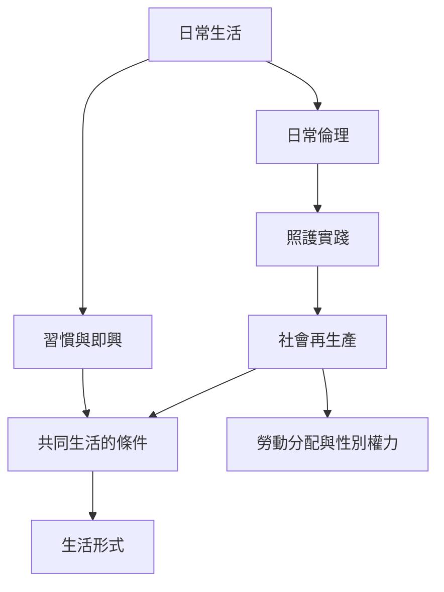

日常生活不是宏觀制度以外的私人領域。照護、家務、情緒支持、習慣與即興回應共同維持人們的生活能力，也讓共同體得以延續。這張地圖從日常行動連到社會再生產與倫理問題。

## 延伸閱讀

可從[[日常生活（Everyday Life）]]與[[日常倫理（Ordinary Ethics）]]開始，接著閱讀[[社會再生產（Social Reproduction）]]及[[照護與維持工作應被視為社會制度的核心]]。最後以[[建立照護勞動盤點讓不可見工作能被共同分擔]]轉成實際行動。

## 參考

* [[日常倫理透過細微照護與即興回應得以實踐]]
* [[照護勞動是維持經濟社會的不可見基礎]]
