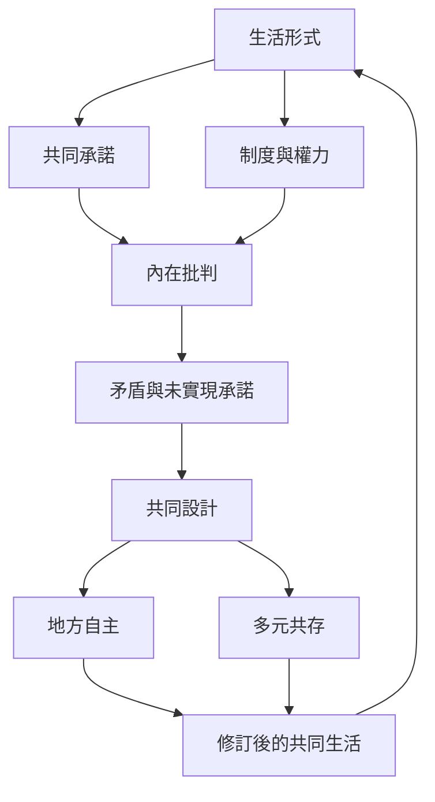

生活形式既能提供共同生活的可理解性，也可能複製不平等。批判需要同時看見內在承諾、照護成本、權力結構與生態後果；設計則應把地方主體性與共同修訂納入制度。

## 延伸閱讀

從[[生活形式批判（Critique of Forms of Life）]]切入，連結[[多重世界（Pluriverse）]]、[[共同化（Commoning）]]與[[社會再生產（Social Reproduction）]]。可用[[進行生活形式批判時先問誰承擔成本與誰有決定權]]作為實務檢核。

## 參考

* [[生活形式可以從自身實踐的困境中接受內在批判]]
* [[設計共同世界需要回應地方性與根本互賴]]
* [[多元生活形式必須在差異共存與權力批判之間取得平衡]]
