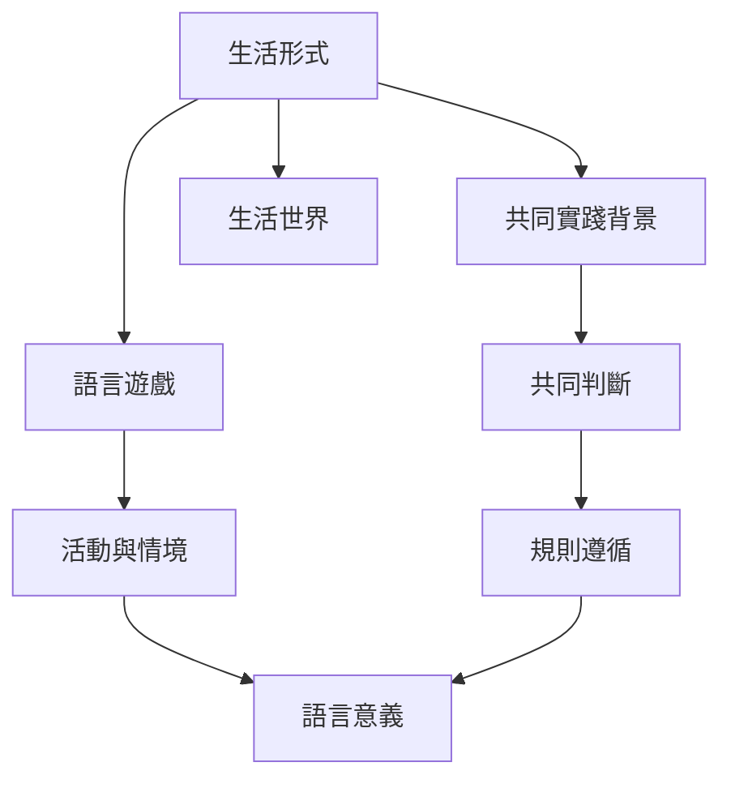

生活形式在維根斯坦哲學中，指向語言、判斷與實踐之間的深層關係。語言遊戲讓詞語進入活動，規則遵循則依賴共同習慣和判斷背景；生活形式因此不是抽象的文化標籤，而是語言得以被理解的實踐背景。

## 延伸閱讀

從[[生活形式（Form of Life）]]開始，接著閱讀[[語言遊戲（Language-game）]]與[[遵循規則（Rule-following）]]，再看[[語言的意義依賴人們如何共同生活與行動]]及[[共同生活不等於所有人持有相同意見]]。

## 參考

* [[生活形式是語言活動得以有意義的共同實踐背景]]
* [[維根斯坦與人類學之間的橋梁是對日常生活的細緻描述]]
