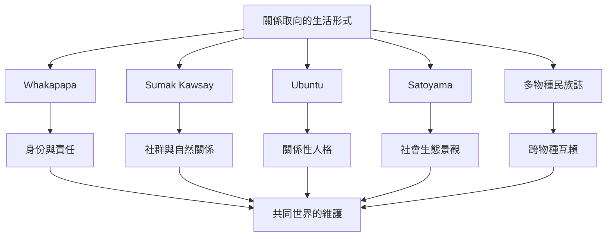

跨文化與生態材料顯示，生活形式可延伸至人與土地、祖先、動植物和地方景觀的關係。不過各概念有自己的歷史與知識主體，應以互相對話而非彼此取代的方式比較。

## 延伸閱讀

可從[[關係本體論（Relational Ontology）]]開始，分別閱讀[[Whakapapa]]、[[Kaitiakitanga]]、[[Sumak Kawsay（Buen Vivir）]]、[[Ubuntu]]、[[Satoyama]]與[[多重世界（Pluriverse）]]。比較時參考[[生活形式的跨文化比較應從實踐相似處而非詞語對等開始]]。

## 參考

* [[Whakapapa將身份與責任連結到人與非人世界]]
* [[Sumak Kawsay的意義必須從在地社群實踐辨析]]
* [[Satoyama是由日常生產與生態互動共同形成的景觀]]
* [[多物種生活揭示廢墟中的互賴與協作]]
