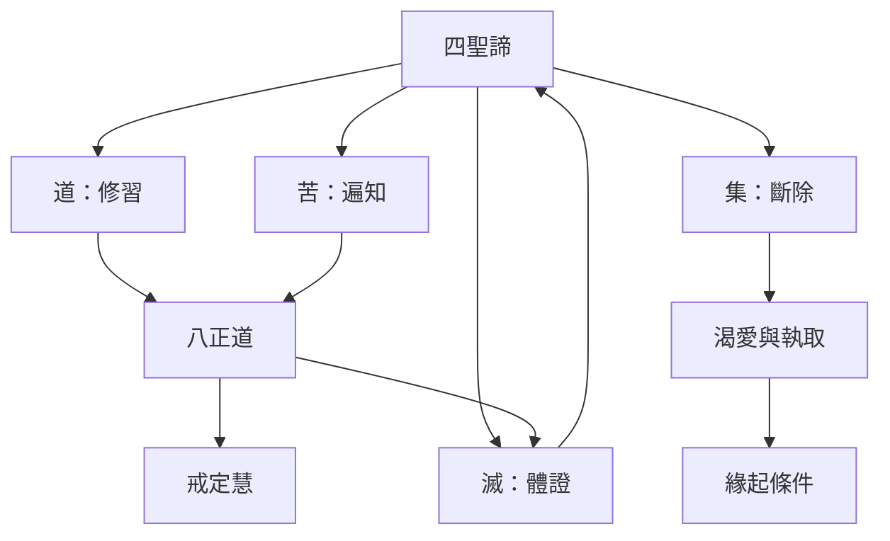

四聖諦把苦的理解、成因的放下、止息的體證與道路的培養連成一個實踐框架。它的四個部分有不同任務，但彼此不能分割：道諦幫助斷集與體證滅，對苦的理解又會深化正見。

概念與論述：[[四聖諦]]、[[苦]]、[[集]]、[[滅]]、[[道]]、[[三轉十二行相]]。
核心筆記：[[四聖諦是一套實踐任務而不只是四個命題]]、[[苦不等於人生全然悲觀而是需要如實辨識的經驗]]、[[渴愛不只是想得到也包含想成為與想消失]]、[[滅是對執取止息的體證而非生命的虛無]]、[[八正道是一套互相支援的生活訓練而非線性清單]]。
文獻入口：[[初轉法輪經將中道八正道與四聖諦連成同一條解脫路徑]]、[[舍利弗在分析經中把八正道具體展開為道諦的內容]]。
延伸實踐：[[用四諦四任務記錄一件正在發生的困境]]、[[用三轉十二行相設計不帶自責的修習回顧]]。
