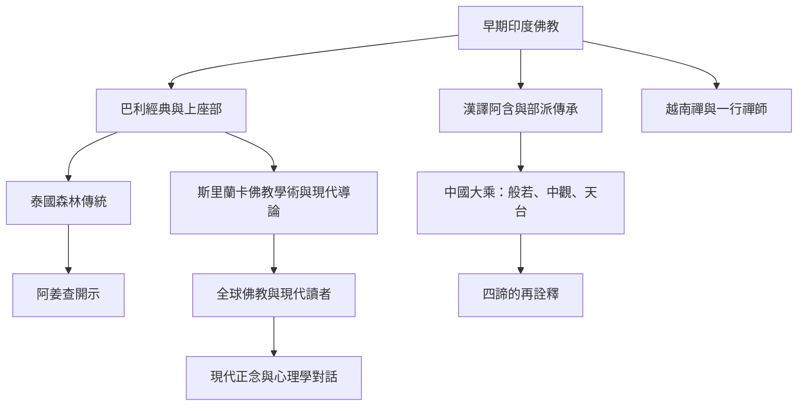

四聖諦從早期印度佛教文本流傳至南亞、東南亞、東亞與全球現代佛教，在各傳統中延續，也被不同教理、禪修方式與社會文化環境重新解釋。跨文化比較需要區分原典、平行本、註釋、教師開示、訪談與現代實證研究。

跨傳統概念：[[四聖諦]]、[[中道]]、[[空性]]、[[緣起]]、[[無我]]。
核心筆記：[[四聖諦在不同佛教傳統中保有框架也發生詮釋變化]]、[[四聖諦需要放回文本與歷史脈絡中理解]]、[[空性不等於否定因果與修行]]、[[現代心理學可與四聖諦對話但不應把兩者混為一談]]。
研究與訪談：[[漢譯轉法輪經與巴利本的異同提醒讀者比較經典傳承]]、[[天台與大智度論研究顯示大乘會重新詮釋四諦]]、[[一行禪師把四聖諦實踐延伸到人際與社會共同體]]、[[2025年田野研究指出正念療法可更深入理解佛教修行脈絡]]。
延伸實踐：[[建立不同傳統與譯本的四諦對讀練習]]、[[把正念課程的成效問題重新放回倫理與生活脈絡]]。
