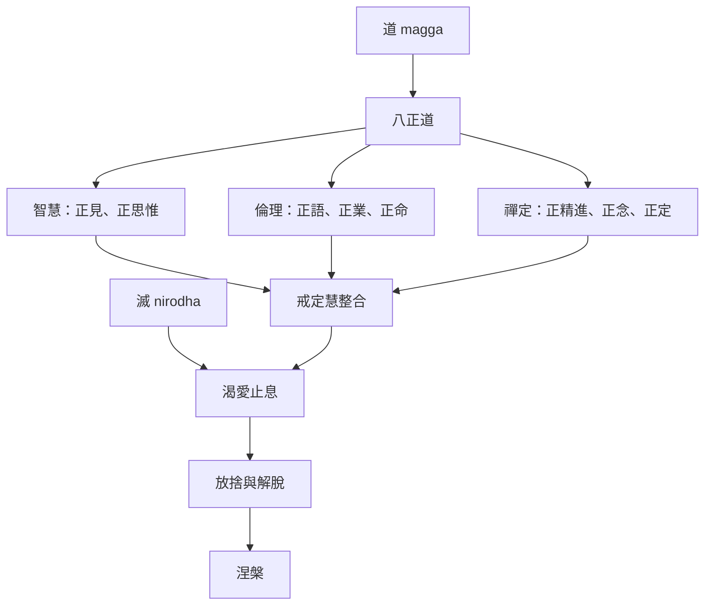

滅諦不是虛無或情緒麻木，而是渴愛與執取止息的解脫方向；道諦則指出這個方向需要透過完整訓練培養。八正道將智慧、倫理與禪定連結起來，戒定慧則提供另一個統整角度。

概念與論述：[[滅]]、[[涅槃]]、[[道]]、[[八正道]]、[[戒定慧]]、[[無我]]。
核心筆記：[[滅是對執取止息的體證而非生命的虛無]]、[[八正道是一套互相支援的生活訓練而非線性清單]]、[[道諦要求培養完整道路而不只追求靜坐技巧]]。
文獻入口：[[舍利弗在分析經中把八正道具體展開為道諦的內容]]、[[阿姜查以不執取與親自驗證解說四聖諦]]、[[葛印卡以親身經驗說明四聖諦不能止於理智理解]]。
延伸實踐：[[把八正道翻譯成每天可觀察的生活實驗]]。
