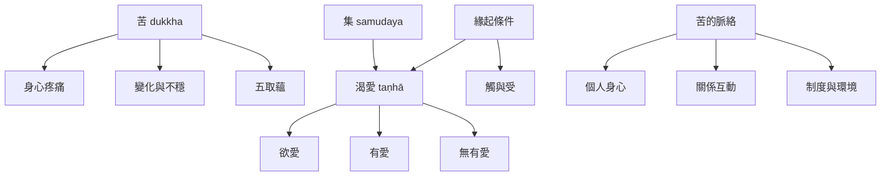

苦諦指出經驗中疼痛、不穩定與不滿足的面向；集諦則追問苦如何依條件生起。渴愛是重要因素，但不應把苦的所有成因縮減為個人欲望。緣起、五蘊與三毒能補充對經驗歷程的理解，而關係與制度條件則提醒我們，苦也具有社會面向。

概念與論述：[[苦]]、[[集]]、[[渴愛]]、[[五蘊]]、[[緣起]]、[[三毒]]。
核心筆記：[[苦的翻譯選擇會改變讀者對四聖諦的理解]]、[[苦的成因也要從關係與制度條件理解]]、[[四聖諦與緣起互補地說明苦如何依條件生起]]。
文獻入口：[[初轉法輪經將中道八正道與四聖諦連成同一條解脫路徑]]、[[佛教心理學研究以四聖諦連結苦與心識訓練]]。
延伸實踐：[[區分原初疼痛與額外執取但不延誤必要照護]]、[[用個人關係制度三個尺度辨識苦的成因]]。
