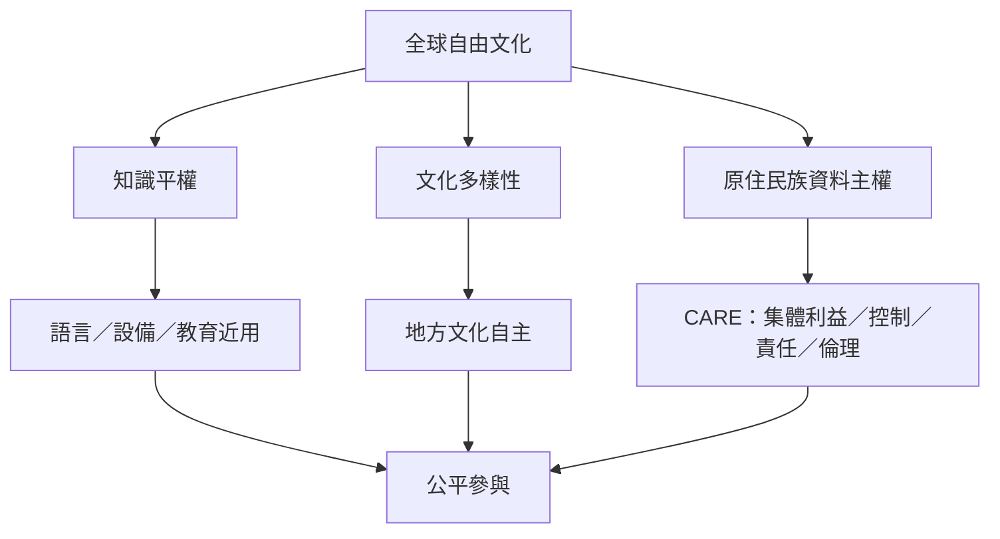

自由文化的全球尺度不只是授權條款跨境通用，也涉及知識近用、語言不平等、文化多樣性、原住民族自決與地方社群治理。全球南方、原住民族社群與弱勢語言的經驗提醒我們：開放必須回答誰能控制、誰能受益、誰能發聲。

相關筆記：[[知識平權不會因內容免費而自動實現]]、[[公共領域狀態不等於社群對文化使用的倫理同意]]、[[開放資料需要結合CARE原則]]、[[文化多樣性要求開放流通同時保留地方文化自主]]、[[全球文化再利用必須處理權力與代表性差異]]。

相關概念：[[文化多樣性]]、[[原住民族傳統知識]]、[[原住民族資料主權]]、[[CARE原則]]、[[文化commons]]、[[自由文化必須尊重原住民族的文化治理權]]、[[知識平權要求誰能生產知識與決定其呈現方式]]、[[資料治理應讓資料主體保有決策權]]、[[全球南方的知識近用必須從在地制度理解]]
