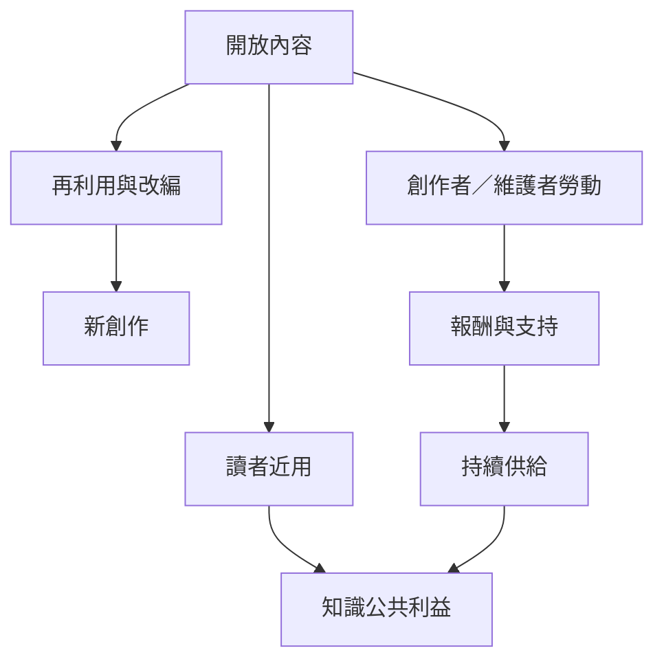

自由文化必須同時思考讀者取得、創作者報酬、志願者勞動與社群維護。開放近用、開放教育資源與開放科學可擴大知識流通，但若成本被轉嫁到作者或志工，仍可能形成新的排除。

相關筆記：[[開放近用使公共資助研究能被更多人閱讀]]、[[開放出版若將費用轉嫁作者仍會製造新的排除]]、[[開放教育資源讓學習者能依在地需求改編教材]]、[[開放科學需要同時公開成果方法與研究限制]]、[[創作者與維護者需要可持續的回饋制度]]。

相關概念：[[開放近用]]、[[開放教育資源]]、[[開放科學]]、[[開放文化勞動]]、[[開放知識]]、[[社區文化的自由需要公共支持而不只是授權]]、[[運動制度化會帶來代表性與議程排序的取捨]]
