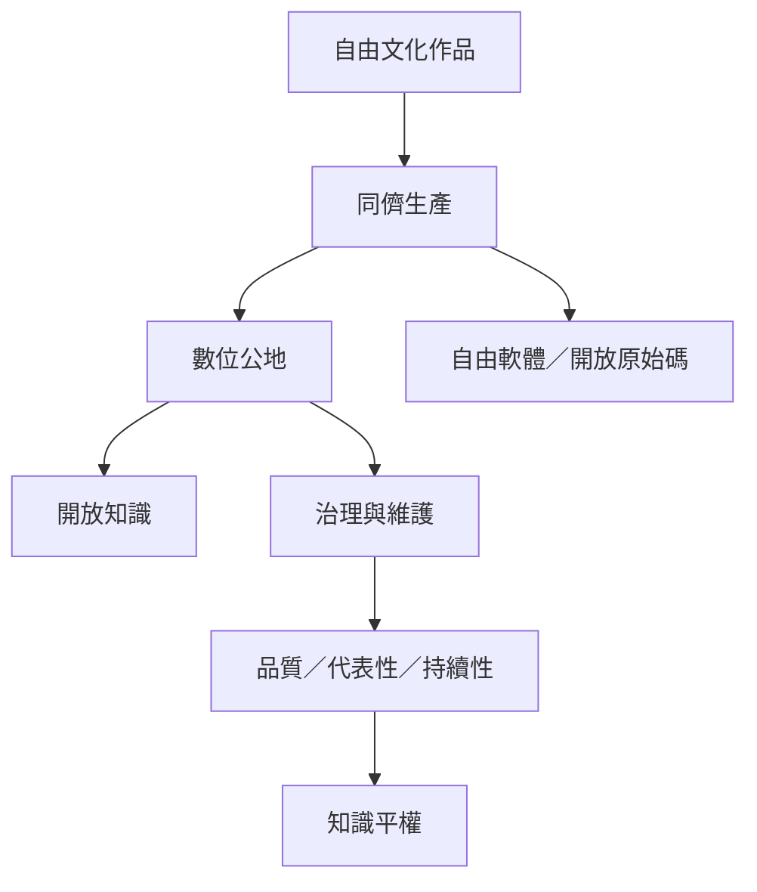

自由文化的生產端依賴數位公地、同儕生產、自由軟體與開放知識。共享成果並不會自動出現，仍需要任務拆解、品質控制、治理、維護工作與可持續的回饋制度。

相關筆記：[[分散式同儕生產能在市場與科層之外組織文化創作]]、[[開放文化需要把維護工作視為正式生產]]、[[開放平台需要主動補足冷門主題與弱勢語言的供給缺口]]、[[創作者與維護者需要可持續的回饋制度]]。

相關概念：[[數位公地]]、[[同儕生產]]、[[自由軟體]]、[[開放原始碼]]、[[開放知識]]、[[開放文化勞動]]、[[文化commons]]、[[志願貢獻容易被平台與組織視為免費資源]]、[[開放與自由的價值語言不完全相同]]
