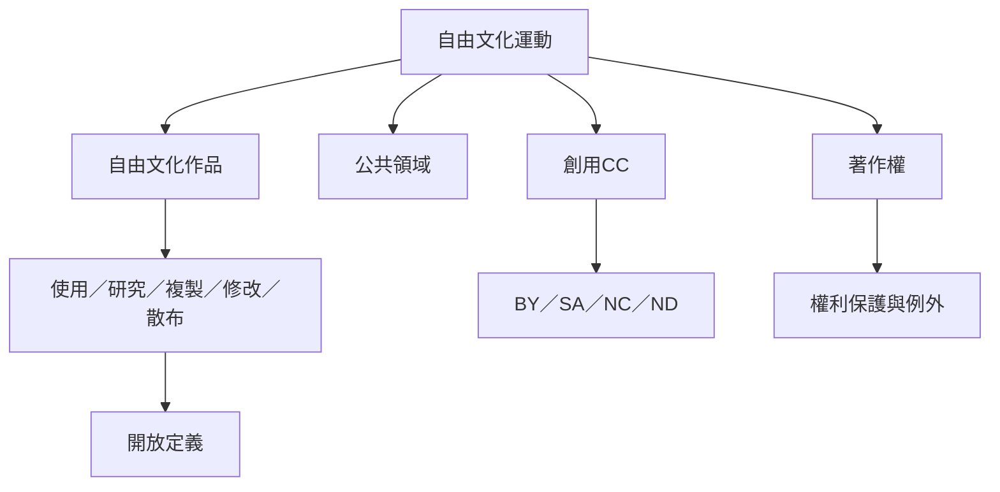

自由文化運動以文化作品可否被使用、研究、複製、修改與再散布作為核心判準。這張地圖連結自由文化作品、公共領域、著作權、創用 CC 與開放定義，幫助讀者區分價格、法律授權與實際使用能力。

相關筆記：[[自由文化指的是使用與再創作自由而非零價格]]、[[公共領域讓文化能在世代之間持續再創作]]、[[自由文化運動不是反對創作者權利而是反對不成比例的文化封鎖]]、[[禁止商業使用與禁止改作會縮窄文化再利用空間]]、[[相同方式分享能讓衍生作品繼續留在共享commons]]。

相關概念：[[自由文化運動]]、[[自由文化作品]]、[[著作權]]、[[公共領域]]、[[創用CC]]、[[開放授權]]、[[合理使用]]、[[開放定義]]、[[自由文化作品需要可編輯的來源形式]]、[[開放授權需要清楚標示來源與衍生版本]]、[[著作權擴張可能形成對文化commons的圈地]]
