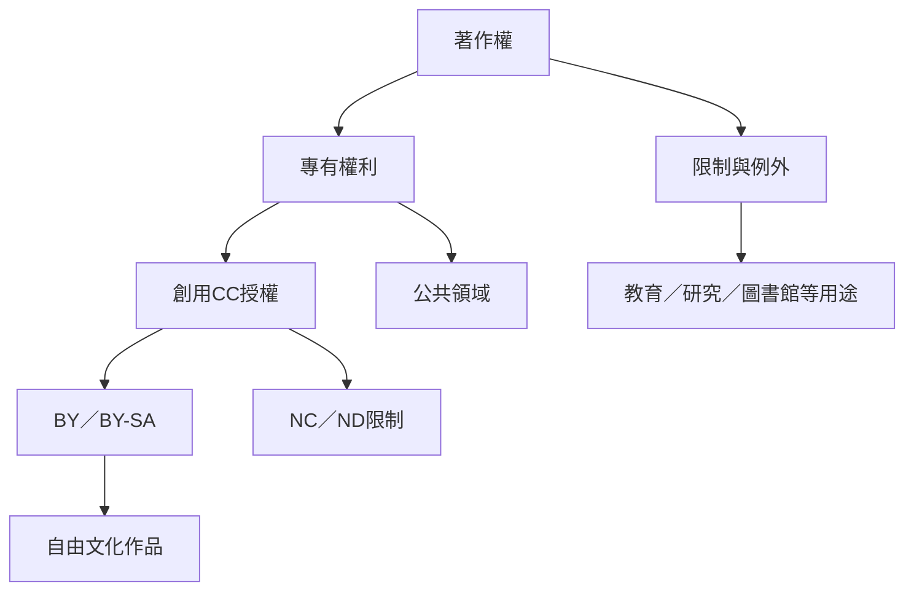

自由文化的法律基礎由著作權、公共領域、限制與例外、開放授權及創用 CC 組成。它不是要求權利消失，而是重新安排權利人、公眾與後續創作者的使用空間。跨國實作需要辨識法域差異、授權兼容與在地化問題。

相關筆記：[[創用CC讓著作權人預先授權而非放棄權利]]、[[著作權例外需要依各國法制與歷史情境理解]]、[[全球授權必須經過語言與法律的在地化]]、[[著作權需要在創作者報酬與公眾再利用之間維持比例]]。

相關概念：[[著作權]]、[[創用CC]]、[[開放授權]]、[[相同方式分享]]、[[合理使用]]、[[公共領域]]、[[著作權限制與例外]]、[[開放授權需要清楚標示來源與衍生版本]]、[[開放與自由的價值語言不完全相同]]
