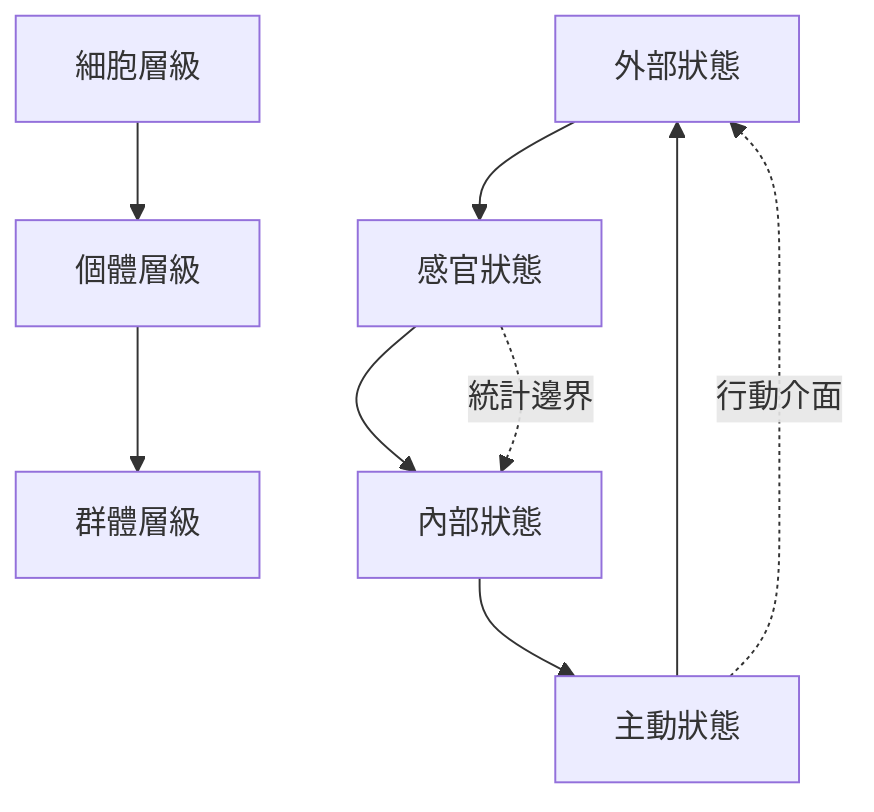

馬可夫毯是統計依賴的概念，可幫助描述內外狀態如何透過感官與主動狀態相互影響。研究者將這種邊界結構延伸到細胞、個體與群體，但各尺度是否真的構成自主系統，須以具體條件與經驗資料檢驗。

## 關係圖

## 概念連結
* [[馬可夫毯]]
* [[自主性]]
* [[非平衡穩態]]
* [[生命維持]]
* [[自我與環境邊界可能是多層次且可變的]]
* [[社會群體可以作為多層耦合的自主系統假說]]
