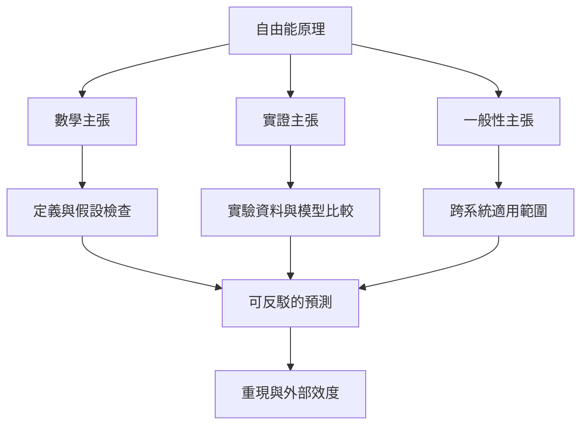

FEP 的研究爭論可以分成三層：數學推導是否成立、具體模型是否符合資料、普遍性主張是否有足夠範圍。批判文獻分別對馬可夫毯定義、推導假設、適用範圍及競爭模型提出問題。

## 關係圖

## 概念連結
* [[自由能原理]]
* [[自由能原理是一個統攝性研究框架而不是單一具體模型]]
* [[馬可夫毯推導中仍有需要交代的數學假設]]
* [[馬可夫毯不會自動證明自由能原理是一切理論]]
* [[自由能原理需要區分數學實證與普遍性主張]]
* [[理論評估必須交代可觀察變項與競爭模型]]
* [[強化學習與主動推論比較應看不同場景的增益]]
