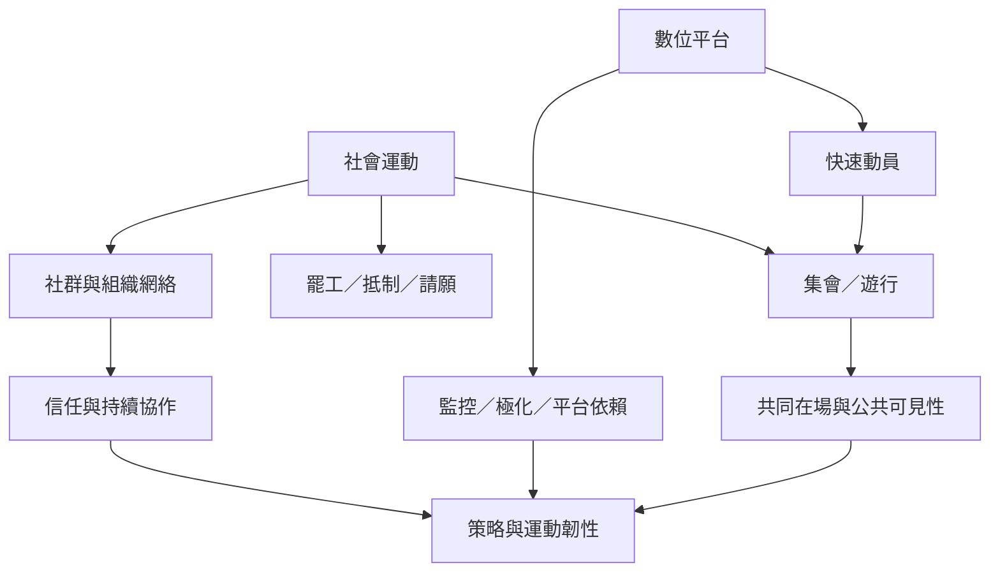

集會是社會運動可見的集體行動形式之一，但運動的持續性還取決於組織網絡、策略、參與多樣性、公共敘事及線上線下協作。數位工具降低動員成本，也提高監控與極化風險；因此應把集會現場、數位平台與長期組織放在同一張分析地圖中。

重要材料包括[[非暴力抗爭的成效來自策略與參與結構而非道德標籤]]、[[社會運動是由歷史形成的集體政治行動形式]]、[[數位工具同時擴大集會動員並加深監控風險]]及[[解放廣場集會顯示群眾聚集具有複雜內部秩序]]。

## Mermaid 關係圖

## 延伸閱讀
* [[集會事件不等於整個社會運動]]用來區分事件與運動尺度。
* [[數位擴張不等於集體能量真正增加]]區分線上觸及與實際協作能力。
* [[集會的內部決策方式會塑造公共性的品質]]分析運動內部如何處理差異。
* 相關概念：[[社會運動]]、[[非暴力抵抗]]、[[數位監控]]、[[公民不服從]]。
