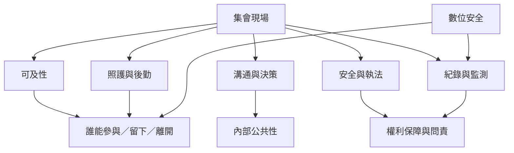

集會權能否落實，取決於現場是否有可及的空間、照護安排、資訊與安全，以及事件是否被獨立、負責任地記錄。這個概念地圖將法規原則轉化為主辦者、觀察者與公共機關可檢驗的實作條件。

本圖連結[[集會監測需要獨立觀察與可驗證紀錄]]、[[集會的基礎設施也是集會權的一部分]]、[[邊緣群體的公共可見性需要集體行動支持]]與[[數位擴張不等於集體能量真正增加]]。

## Mermaid 關係圖

## 延伸閱讀
* [[把社區共學與互助聚會視為日常集會自由的實踐]]將集會延伸至日常公共生活。
* [[建立集會友善度檢核表讓權利保障能被實際觀察]]提供現場工具方向。
* [[讓集會照護工作成為集體行動的共同責任]]處理照護分工。
* 相關概念：[[和平集會]]、[[公民觀察]]、[[人群管理]]、[[數位監控]]。
