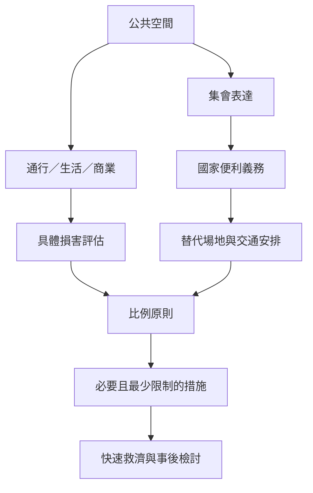

集會通常發生在街道、公園、廣場或其他公共場域，因而與交通、商業、居住、安全及其他群體的權利交會。爭議不應被簡化成「自由或秩序」的選擇，而要具體分析限制的目的、風險、持續時間、替代方案與表達效果。

此圖以[[公共空間]]、[[比例原則]]及[[人群管理]]為中心，連結[[歐洲人權法要求對和平集會保持一定容忍]]、[[印度 Shaheen Bagh 案凸顯抗議與公共通行權的平衡難題]]、[[南韓憲法法院認為全面禁止夜間戶外集會違憲]]與[[台灣大法官將集會自由連結公意形成與民主監督]]。

## Mermaid 關係圖

## 延伸閱讀
* [[公共空間的衝突應以具體損害與比例調節處理]]是本圖的核心永久筆記。
* [[解放廣場集會顯示群眾聚集具有複雜內部秩序]]提醒空間不只有交通用途，也形成臨時社會關係。
* [[比較替代場地是否真的保留抗議的政治可見度]]可延伸為實務研究題目。
* 相關概念：[[公共空間]]、[[比例原則]]、[[人群管理]]、[[抗議權]]。
