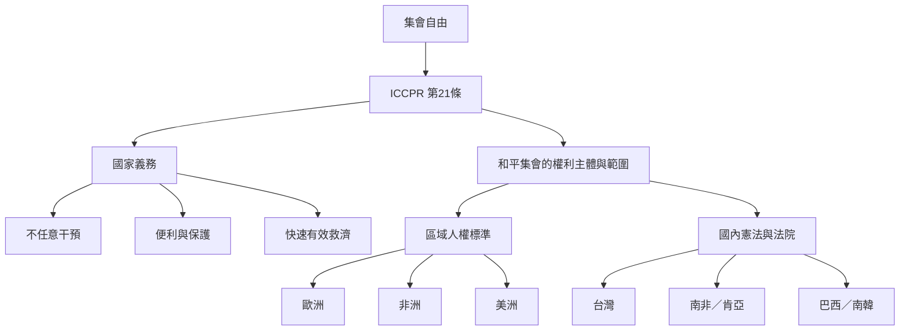

集會自由的國際框架以《公民與政治權利國際公約》第 21 條為共同起點，並由區域人權系統、憲法與法院判決進一步具體化。分析時要同時理解消極義務（不得任意干預）與積極義務（便利、保護與提供救濟）。

核心概念包括[[集會自由]]、[[和平集會]]、[[結社自由]]、[[比例原則]]與[[通知制度]]。重要比較材料包括[[和平集會是個人自主在團結中的集體實踐]]、[[非洲區域標準要求國家保障結社與集會自由]]、[[美洲人權標準要求以比例原則處理社會抗爭]]、[[台灣大法官將集會自由連結公意形成與民主監督]]、[[南非憲法將示威糾察與請願列為明文權利]]、[[肯亞憲法將和平示威與向公權力請願列為基本權]]及[[巴西憲法保障公共場所無須事前許可的和平集會]]。

## Mermaid 關係圖

## 延伸閱讀
* 通知與許可：[[通知制度應服務集會便利而非變相許可]]、[[自發集會是民主即時回應不可或缺的形式]]、[[集會自由的實質保障需要快速有效的救濟]]。
* 國家積極義務：[[國家義務不只是避免干預也包括促進與保護]]、[[集會的基礎設施也是集會權的一部分]]。
* 核心法源：[[和平集會是個人自主在團結中的集體實踐]]、[[集會管理應以促進而非預設禁止為出發點]]。
