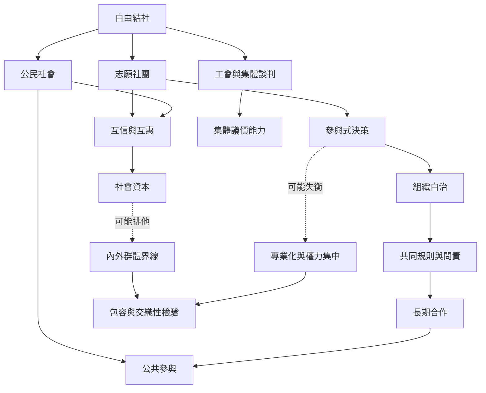

自由結社的社會意義，是讓人們在日常生活中練習共同制定規則、交換資源、代表利益與參與公共決策。組織的民主品質不只取決於規模與存續，也取決於成員是否能實際參與、提出異議及改變方向。社會理論提供不同觀察角度：Tocqueville 關心結社習慣與自治能力，Putnam 關心公民網絡與制度表現，Skocpol 提醒專業化可能取代會員參與，Polletta 展示參與式民主的實際試驗，Ostrom 則分析自治規則如何支持長期合作。

## 參考

* [[Tocqueville Putnam Skocpol與Polletta從不同角度解釋結社如何形塑民主]]。
* [[自由結社讓個人能把分散力量轉化為持續的集體行動]]、[[公民團體是民主社會中練習合作與共同治理的基礎設施]]、[[工會自由把分散的勞動者轉化為集體議價者]]。
* [[組織參與品質不能以社團數量或會員名冊代替]]、[[團體凝聚力也可能形成排斥與權力不平等]]。
* 概念：[[志願社團]]、[[公民社會]]、[[社會資本]]、[[集體行動]]、[[工會]]、[[集體談判]]、[[共有資源治理]]。
