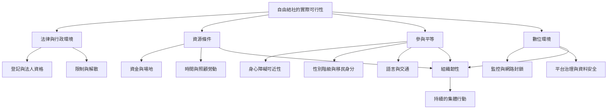

形式上有結社權，仍不足以保證人們能持續組織。登記門檻、資金限制、監控、網路封鎖、雇主報復、照顧負擔與無障礙不足，都可能讓部分人無法行使權利。這張地圖將結社自由的法律保障連到公民空間、交織性、資源自主與日常社群設計。

## 參考

* [[CIVICUS與聯合國報告顯示公民空間受限也包含資金與數位干預]]、[[ITUC 2026年指數指出工會受監控與打壓的風險持續升高]]。
* [[形式平等的結社權仍可能受時間資源與身分差異限制]]、[[數位結社讓組織更容易擴散也更容易被監控]]、[[組織自主需要可持續且不受任意剝奪的資源]]。
* [[結社自由的平等實踐需要主動降低參與門檻]]、[[社群的資源制度應防止單一資助者左右共同議程]]、[[數位社群應保留線下關係與多重通訊管道]]。
* 概念：[[公民空間]]、[[交織性]]、[[數位結社]]、[[非政府組織]]。
