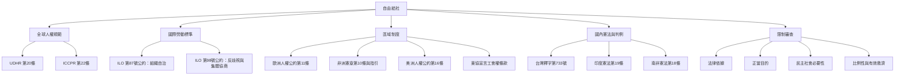

自由結社的保障由普遍人權規範、國際勞動標準、區域制度、國內憲法與判例共同構成。閱讀時先辨認權利主體與組織類型，再檢查國家干預是否符合合法性、正當目的、必要性及比例性。區域條約的拘束力與監督救濟機制並不相同，不能將一地判例直接視為全球規則。

## 參考

* [[國際人權規範將自由結社確立為集體行動的基本權利]]、[[ILO第87號公約以組織自主與免受干預保障工會自由]]、[[ILO第98號公約要求防止反工會歧視並保障集體協商]]。
* [[歐洲人權公約第11條透過判例保障政黨工會與民間組織]]、[[非洲人權憲章與2017年指引重視非正式結社及通知制登記]]、[[美洲人權公約涵蓋多元結社目的而東協宣言主要明列工會權]]。
* [[台灣印度與南非憲法以不同方式保障人民組織團體的自由]]。
* 概念：[[自由結社]]、[[積極結社自由]]、[[消極結社自由]]、[[結社自治]]、[[法人格]]、[[和平集會自由]]。
