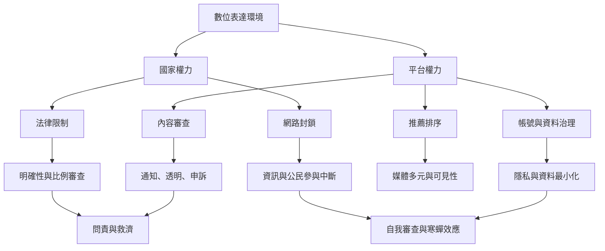

本圖把數位表達自由的主要權力節點放在一起：國家可以透過法律與網路封鎖控制通訊，平台則能透過內容審查、推薦排序與帳號管理影響可見性；監控與不透明規則可能進一步形成寒蟬效應。

可從 [[數位平台已成為私人掌控的公共表達基礎設施]]、[[網路封鎖不只是斷線而是切斷公民參與的基礎設施]]、[[自我審查是言論自由受限的隱性指標]] 開始；概念參見 [[Platform_governance|平台治理]]、[[Digital_rights|數位權利]]、[[Privacy|隱私權]]、[[Chilling_effect|寒蟬效應]]。

本卡片屬於 [[Freedom_of_speech|言論自由專書]]。
